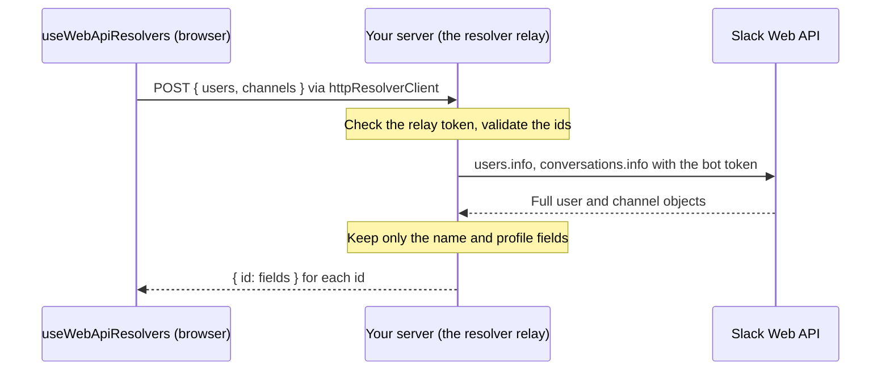

Slack's mrkdwn and rich text only ever carry ids (`<@U0123ABC>`, `<#C0123ABC>`, `<!subteam^S0123>`),
never names. `@nkootstra/block-kit` never fetches on your behalf; you supply `resolvers` and it renders
whatever they return, the same way Slack's own client resolves ids against its cache.

<Preview
  payload={{
    blocks: [
      {
        type: "section",
        text: {
          type: "mrkdwn",
          text: "<@U0ADA> assigned this to <!subteam^S0ENG|@engineering> in <#C0RELEASES>.",
        },
      },
    ],
  }}
/>

## The Resolvers shape

Pass `resolvers` to `<BlockKitProvider>`. Each function is synchronous: return a name if you have it,
or `undefined` if you don't (yet):

```tsx
import { BlockKitProvider, Message, type Resolvers } from "@nkootstra/block-kit";

const resolvers: Resolvers = {
  user: (id) => ({ U0ADA: "Ada Lovelace" })[id],
  channel: (id) => ({ C0RELEASES: "releases" })[id],
  usergroup: (id) => ({ S0ENG: "engineering" })[id],
  userProfile: (id) =>
    id === "U0ADA"
      ? {
          name: "Ada Lovelace",
          title: "Staff Engineer",
          pronouns: "she/her",
          avatarUrl: "https://cdn.block-kit.dev/samples/beagle.e3711bc4.jpg",
          status: { emoji: "palm_tree", text: "On vacation" },
          timeZone: "Europe/Amsterdam",
        }
      : undefined,
};

<BlockKitProvider resolvers={resolvers}>
  <Message blocks={[{ type: "section", text: { type: "mrkdwn", text: "<@U0ADA>" } }]} />
</BlockKitProvider>;
```

<TypeTable
  type={{
    user: {
      type: "(id: string) => string | undefined",
      description: 'Display name for a user mention, e.g. <@U0ADA> → "Ada Lovelace".',
    },
    userProfile: {
      type: "(id: string) => UserProfile | undefined",
      description:
        "Details for the profile card that opens when a user mention is clicked. Falls back to the name from user when omitted.",
    },
    channel: {
      type: "(id: string) => string | undefined",
      description: 'Name for a channel mention, e.g. <#C0RELEASES> → "releases".',
    },
    usergroup: {
      type: "(id: string) => string | undefined",
      description: 'Name for a usergroup (subteam) mention, e.g. <!subteam^S0ENG> → "engineering".',
    },
    slackFile: {
      type: "(file: { id?: string; url?: string }) => { url: string; size?: number } | undefined",
      description:
        "A slack_file image's loadable URL and its size in bytes, e.g. from files.info. The image block and image element show it like an image_url, with Slack's \"(400 kB)\" caption (decimal kilobytes) when the size is known; an image block's file shows at most 400 x 400. Without it, an image block shows the alt-text placeholder.",
    },
    imageSize: {
      type: "(url: string) => number | undefined",
      description:
        "An image_url image block's size in bytes, shown as Slack's \"(72 kB)\" caption beside the caret. Slack shows the size of the image it downloaded; block-kit doesn't download it, so without this the caption is left out.",
    },
    directory: {
      type: '(source: "users" | "conversations" | "channels") => DirectoryEntry[] | undefined',
      description:
        'The people and channels a users, conversations or channels select lists, in order: { type: "user", id, name, realName?, avatarUrl?, self?, badge?, bot?, presence? } or { type: "channel", id, name, private? }. A chosen id it lists shows that entry\'s name.',
    },
    app: {
      type: "(id: string) => { iconUrl?: string } | undefined",
      description:
        "An app's icon, e.g. from bots.info, shown at 16px in a rich text work_object_mention with that app_id. Without it the mention shows a placeholder square where Slack shows the icon.",
    },
  }}
/>

`UserProfile` fields: `name` (required), `realName`, `title`, `pronouns`, `avatarUrl`, `status: {
emoji?, text? }`, and `timeZone` (an IANA zone, used for the card's "local time" row).

Resolvers run in the browser, so everything they return is in the page. Give a viewer only the
people, channels and fields they may see; [Untrusted input](/guides/untrusted-input#resolvers-return-your-data-to-the-page)
covers `directory`, `slackFile` and `imageSize`.

## What unresolved ids look like

An id a resolver returns `undefined` for renders exactly like Slack's client does when it hasn't
cached that id yet: not an error, not the raw id:

- **A user mention in mrkdwn or a Home tab/modal's plain mrkdwn text** (`<@U0123>` with no
  resolver hit) falls back to `@U0123` in the surrounding text's colour and weight, in a span of its
  own as in Slack. Slack doesn't show a loading pill for it either.
- **A user mention in a `rich_text` block** shows an empty loading pill (a small grey bar),
  matching Slack's Builder while it's still resolving a mention it hasn't seen before. Resting
  the pointer on a user's pill shows Slack's "Private user info" tooltip. That's a user mention with
  no `user` resolver at all: when `resolvers.user` is given and returns `undefined`, the user
  doesn't exist, and the mention shows the empty outline Slack draws once its lookup settles on a
  user it can't find.
- **A channel mention with no `channel` resolver hit and no inline label** (`<#C0123>` without
  `|name`) renders as a locked "Private channel" pill, since Slack can't show a name for a channel the
  viewer isn't in either. Resting the pointer on it shows Slack's hover card explaining why: "You
  don't have access to this channel (ex. it's private or in a workspace you're not a part of), so
  its name isn't shown".
- **A usergroup mention**, in mrkdwn or `rich_text`, shows Slack's empty outline until resolved,
  with an "Unavailable user group info" tooltip. There's no unresolved fallback text for subteams,
  matching Slack.

<Preview
  payload={{
    blocks: [
      { type: "section", text: { type: "mrkdwn", text: "Unresolved user: <@U0UNKNOWN>" } },
      { type: "section", text: { type: "mrkdwn", text: "Unresolved channel: <#C0UNKNOWN>" } },
    ],
  }}
/>

## The profile card

Clicking a resolved user mention opens a popover (Slack's `p-member_profile_card`) built from
`resolvers.userProfile`. It shows the avatar (or an initial), name and pronouns, real name and title if
they differ from the display name, a custom status with its emoji, and local time when `timeZone` is
set. Without a `userProfile` resolver it still opens, showing just the name from `user`.

## Linking mentions to your app

`mentionHref` turns resolved mentions into links to your own pages, and `linkComponent` sends every
link in a message through your router. See [Linking to your app](/guides/linking-to-your-app).

## Resolving names from the Slack Web API

`@nkootstra/block-kit/web-api` builds `Resolvers` from three Web API methods: `users.info` for a
user's name and profile card, `conversations.info` for a channel, and `usergroups.list` once for every
usergroup id (the Web API has no per-id usergroup lookup). Those calls need your bot token, and the
bot token must never reach the browser, so the lookups run on your server. There are two ways to set
that up:

- **A relay**, when the page decides which ids it needs: `createResolverRelay` answers lookups on
  your server, and `httpResolverClient` asks it from the browser.
- **Resolve on the server**, when you render the page on the server: look the ids up there and hand
  the browser plain `{ id: name }` maps.

[`examples/nextjs`](https://github.com/nkootstra/block-kit/tree/main/examples/nextjs) and
[`examples/vite-hono`](https://github.com/nkootstra/block-kit/tree/main/examples/vite-hono) show both,
and run without a Slack workspace.

## Keep the bot token on the server

A bot token (`xoxb-…`) is your app's identity in the workspace: whoever has it can call the Web API as
your app, with every scope it was granted. Code that constructs a `WebClient` next to
`useWebApiResolvers` runs in the browser, so the token has to be in the page's JavaScript for it to
work. Then anyone who opens the page can read it out of the bundle. If the environment variable isn't
exposed to the browser, the lookups just fail, and the usual "fix" is a `NEXT_PUBLIC_` or `VITE_`
prefix, which publishes the token.

The same trust boundary as the [signing secret](/guides/connecting-your-app#why-the-signing-secret-must-stay-server-side)
applies: only your server holds the bot token, and the browser only talks to your own origin.



Whoever can reach the relay can look up every name the bot can see, so give the bot a token with only
the scopes these lookups need:

| Lookup               | Method               | Scope                                                         |
| -------------------- | -------------------- | ------------------------------------------------------------- |
| User names, profiles | `users.info`         | `users:read`                                                  |
| Channel names        | `conversations.info` | `channels:read`, plus `groups:read` only for private channels |
| User group names     | `usergroups.list`    | `usergroups:read`                                             |

Never add `users:read.email`: nothing here reads an email address.

The same goes for everything else that needs the token: [`slack_file` images](/blocks/image#slack-files)
and the [directory](/elements/select-menus) a users or conversations select lists come from your
server too.

## The resolver relay

On the server, `createResolverRelay` from `@nkootstra/block-kit/server` answers the lookups with your
`WebClient`. It's a Fetch API `(Request) => Response` handler, like the interaction relay:

```ts app/api/slack/resolve/route.ts
import "server-only";
import { WebClient } from "@slack/web-api";
import { createResolverRelay } from "@nkootstra/block-kit/server";

const client = new WebClient(process.env.SLACK_BOT_TOKEN, {
  // Answer "try again later" instead of holding the request while Slack's rate limit resets.
  rejectRateLimitedCalls: true,
  retryConfig: { retries: 1 },
});

export const POST = createResolverRelay({
  client,
  // A development secret the page sends along; see below.
  token: process.env.NEXT_PUBLIC_SLACK_RELAY_TOKEN,
});
```

<TypeTable
  type={{
    client: {
      type: "WebApiClient",
      required: true,
      description:
        "A WebClient from @slack/web-api, or anything with users.info, conversations.info and usergroups.list.",
    },
    token: {
      type: "string",
      description:
        "When set, a request without Authorization: Bearer <token> gets a 401, before its body is read. Without it, the relay answers anyone who can reach it.",
    },
    maxIds: {
      type: "number",
      description:
        "The most ids one request may ask for. Defaults to 100, which is also the ceiling.",
    },
    onError: {
      type: "(error: unknown) => void",
      description:
        "Called with the Slack errors the relay answers 502 or 429 for. The response itself never includes them.",
    },
  }}
/>

It only calls those three methods, accepts only ids in Slack's formats (`U0123456789`,
`C0123456789`) and at most 100 of them per request, and returns only the fields mentions and the
profile card use: never an email, a phone number or the rest of the user object. A request that isn't
JSON is refused, so a form on another site can't post to it.

### Development and previews only

Like the [interaction relay](/guides/connecting-your-app), the resolver relay is development and
preview tooling. Don't deploy it publicly: without a `token`, anyone who can reach the route can look
up any user and channel the bot can see.

- Set `token` whenever the route is reachable beyond your machine: a tunnel, a preview deploy, a
  shared network.
- The relay token is a development secret shared with the page, not a Slack credential, so it's fine
  in browser code (and in a `NEXT_PUBLIC_` or `VITE_` variable). Pass the same value to
  `httpResolverClient`.
- The bot token is the opposite: it never leaves the server, and it has only the scopes above.

## In the browser: httpResolverClient

`httpResolverClient` from `@nkootstra/block-kit/transport` stands in for the `WebClient`: it asks your
relay, and lookups made in the same tick go out as one request.

```tsx app/slack-preview.tsx
"use client";

import type { AnyBlock } from "@slack/types";
import { BlockKitProvider, Message } from "@nkootstra/block-kit";
import { httpResolverClient } from "@nkootstra/block-kit/transport";
import { useWebApiResolvers } from "@nkootstra/block-kit/web-api";

const client = httpResolverClient({
  url: "/api/slack/resolve",
  token: process.env.NEXT_PUBLIC_SLACK_RELAY_TOKEN,
});

export function SlackPreview({ blocks }: { blocks: AnyBlock[] }) {
  const resolvers = useWebApiResolvers(client);
  return (
    <BlockKitProvider resolvers={resolvers}>
      <Message blocks={blocks} />
    </BlockKitProvider>
  );
}
```

Create the client once, outside the component: the resolvers belong to the client they were made
with, so a new client on every render would start every lookup over. `token` is sent as
`Authorization: Bearer <token>`; `headers` adds any others.

`useWebApiResolvers` re-renders the component whenever a lookup completes, so a mention that started
unresolved shows its name once it arrives. `createWebApiResolvers` is the same without React: call
`subscribe` to hear when a lookup completes. Because the resolver functions must stay synchronous, a
lookup that hasn't finished returns `undefined` and schedules a background fetch; lookups made within
`batchWindowMs` (default 20ms) are sent together.

They implement `user`, `channel`, `usergroup` and `userProfile`: the profile card's name, title,
pronouns, avatar, status and local time come from the same `users.info` call as the name.

## Resolve on the server instead

When a Server Component (or any server-rendered page) has the blocks, it can look the ids up itself
and pass the browser only the names. Nothing about Slack reaches the client, not even a relay to ask:

```tsx app/page.tsx
import "server-only";
import { WebClient } from "@slack/web-api";
import { SlackPreview } from "./slack-preview";

const slack = new WebClient(process.env.SLACK_BOT_TOKEN);

/** Looks every id up at once, leaving out the ones Slack doesn't know. */
async function resolveAll(ids: string[], name: (id: string) => Promise<string | undefined>) {
  const found = await Promise.allSettled(ids.map(async (id) => [id, await name(id)] as const));
  return Object.fromEntries(
    found.flatMap((r) => (r.status === "fulfilled" && r.value[1] ? [r.value] : [])),
  );
}

export const dynamic = "force-dynamic";

export default async function Page() {
  const blocks = await loadBlocks();
  // The ids in the blocks' mentions; the examples include a small collector.
  const ids = mentionIds(blocks);
  const [names, channelNames] = await Promise.all([
    resolveAll(ids.users, async (user) => {
      const res = await slack.users.info({ user });
      return res.user?.profile?.display_name || res.user?.real_name;
    }),
    resolveAll(ids.channels, async (channel) => {
      return (await slack.conversations.info({ channel })).channel?.name;
    }),
  ]);
  return <SlackPreview blocks={blocks} names={names} channelNames={channelNames} />;
}
```

```tsx app/slack-preview.tsx
"use client";

import type { AnyBlock } from "@slack/types";
import { BlockKitProvider, Message } from "@nkootstra/block-kit";

export function SlackPreview(props: {
  blocks: AnyBlock[];
  names: Record<string, string>;
  channelNames: Record<string, string>;
}) {
  return (
    <BlockKitProvider
      resolvers={{ user: (id) => props.names[id], channel: (id) => props.channelNames[id] }}
    >
      <Message blocks={props.blocks} />
    </BlockKitProvider>
  );
}
```

The props are plain objects, so they cross from the server to the client like any other props.

## Related

<CardGroup cols={2}>
  <Card title="Linking to your app" href="/guides/linking-to-your-app" icon="at-sign">
    Link mentions to your own pages and route links through your router.
  </Card>
  <Card title="mrkdwn" href="/guides/mrkdwn" icon="hash">
    Every mention syntax the parser understands.
  </Card>
  <Card title="Handling actions" href="/guides/interactivity" icon="mouse-pointer-click">
    The ids you'll see in state.values and payloads are the same ones resolvers work from.
  </Card>
  <Card title="Connecting your app" href="/guides/connecting-your-app" icon="plug">
    The interaction relay, and why the signing secret stays on the server too.
  </Card>
</CardGroup>
